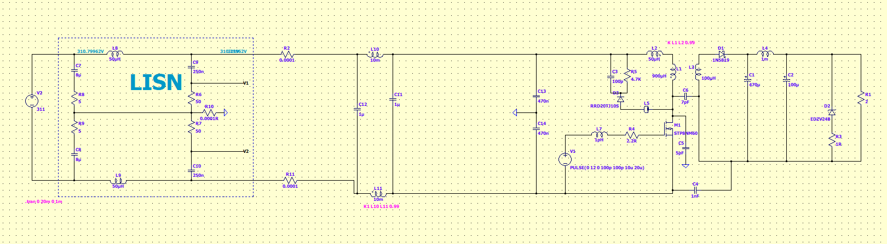

# EMC Test – Conducted EMI Simulation of an Offline Flyback Converter

LTspice model for checking the **conducted emissions** of a single-switch flyback converter, measured through a standard **LISN** (Line Impedance Stabilization Network) and an input EMI filter.

## Files

| File | Description |
|------|-------------|
| `EMC test.asc` | LTspice schematic (the only source file) |
| `EMC test.log` | Simulation log |
| `EMC test.raw` / `EMC test.op.raw` | Simulation waveforms (generated, ~170 MB) |
| `docs/schematic.png` | Schematic screenshot |

## Circuit Overview

The signal path runs left to right: **source → LISN → EMI filter → flyback converter → output**.

### 1. Source
- **V2**: 311 V DC, the peak of a rectified 220 Vac mains.

### 2. LISN (dashed box)
Sits between the source and the device under test on both lines (L/N):

| Part | Value | Role |
|------|-------|------|
| L8, L9 | 50 µH | Line inductors, block noise from going back to the source |
| C7, C8 + R8, R9 | 8 µF + 5 Ω | Source-side decoupling to the return |
| C9, C10 | 250 nF | Couple the HF noise into the measurement resistors |
| R6, R7 | 50 Ω | Receiver impedance; the noise is read here |
| R10 | 0.1 mΩ | Ties the LISN midpoint to earth |

**Measurement nodes:** `V1` (line) and `V2` (neutral). Plot `V(V1)` / `V(V2)` and run an FFT to get the conducted emission spectrum.

### 3. EMI Input Filter
| Part | Value | Role |
|------|-------|------|
| R2, R11 | 0.1 mΩ | Current-sense / probe points |
| L10, L11 (`K1 L10 L11 0.99`) | 10 mH | Common-mode choke |
| C11, C12 | 1 µF | X capacitors (differential mode) |
| C13, C14 | 470 nF | Y capacitors to earth (common mode) |

### 4. Flyback Converter
| Part | Value | Role |
|------|-------|------|
| M1 | STP8NM60 | 600 V primary MOSFET |
| V1 | `PULSE(0 12 0 100p 100p 10u 20u)` | Gate drive: 12 V, **50 kHz, 50 % duty** |
| R4, L7 | 2.2 Ω, 1 pH | Gate resistor and gate-loop inductance |
| L1 | 900 µH | Transformer primary |
| L2 | 50 µH | Leakage / series inductance (`K L1 L2 0.99`) |
| L3 | 100 µH | Transformer secondary |
| R5, C3, D3 | 4.7 kΩ, 100 pF, RRD20TJ10S | RCD snubber/clamp |
| L5 | 145 nH (Würth 742792114) | Ferrite bead in the clamp path |

**Parasitic coupling paths (the actual sources of common-mode noise):**
| Part | Value | Models |
|------|-------|--------|
| C5 | 5 pF | MOSFET drain → heatsink/earth |
| C6 | 7 pF | Primary → secondary winding capacitance |
| C4 | 1 nF | Y capacitor, secondary return → primary return |

### 5. Output Stage
| Part | Value | Role |
|------|-------|------|
| D1 | 1N5819 | Schottky output rectifier |
| C1 | 470 µF (Würth WCAP-ATUL) | Output bulk capacitor |
| L4, C2 | 1 mH, 100 µF (Würth WCAP-ASLI) | Second-stage LC filter |
| R1 | 2 Ω | Load |
| D2 + R3 | EDZV24B, 1 Ω | 24 V zener clamp / overvoltage protection |

## Running the Simulation

1. Open `EMC test.asc` in **LTspice** (tested with LTspice 26.0.2).
2. Run. The analysis is `.tran 0 20m 0 1m`: 20 ms transient with a 1 ms max timestep.
3. Probe `V1` and `V2` on the LISN.
4. Use **View → FFT** on these nodes to see the conducted noise spectrum (150 kHz – 30 MHz band for CISPR 22/32).

> Tip: to get a usable FFT, cut the start-up transient (e.g. analyse 10 ms – 20 ms) and lower the max timestep (e.g. `.tran 0 20m 10m 10n`). Expect a much larger `.raw` file if you do.

## Known Issues / Notes

- **Transformer coupling:** the directive is `K L1 L2 0.99`, so L1 is coupled to the 50 µH series inductor L2 and **not to the secondary L3**. If L3 is meant to be the secondary winding, change it to `K L1 L3 0.99` (and model leakage with L2 left uncoupled).
- The log warns that **nodes `n015` and `n016` are floating**. Check the wiring around the output / secondary side.
- LTspice automatically raised the parallel capacitance of C1 (to 470 pF) and C2 (to 100 pF).
- `*.raw` files are generated output and very large. Keep them out of version control (e.g. with a `.gitignore` entry `*.raw`).